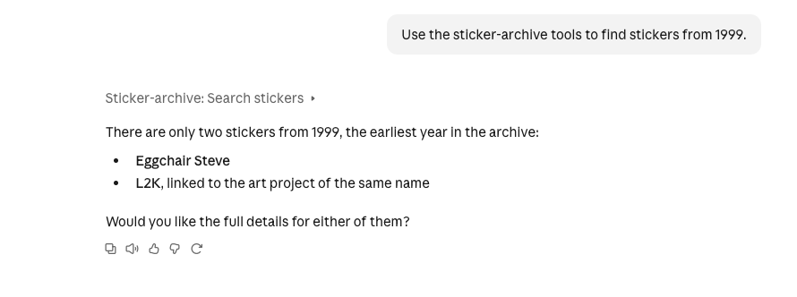

# Sticker Archive MCP

**Chat with the Burning Man Sticker Archive in Claude.**

An [MCP (Model Context Protocol)](https://modelcontextprotocol.io) server that lets Claude search the 396 stickers in my archive at [burningmanstickers.org](https://burningmanstickers.org), covering 1999 to 2026. Ask a question in plain English, and Claude decides which tool to use, calls it and answers from the real data.

> 🎥 **Demo video:** _coming soon_
> 🌐 **Try it live:** _coming soon (online version in progress)_

---

## What it looks like




**Example questions:**

- "What stickers do I have from 2020?"
- "Show me stickers from Camp Balls."
- "Which stickers mention the Temple?"
- "Tell me everything about the sticker 2011-model."

---

## Why I built it

I run burningmanstickers.org and a weekly Instagram series spotlighting individual stickers. I wanted to:

1. **Learn MCP by building something real**, alongside the DeepLearning.AI course _MCP: Build Rich-Context AI Apps with Anthropic_, rather than only following the course examples.
2. **Make my own archive conversational**, so I can ask questions about it instead of scrolling through a CMS.
3. **Show how I work with AI tools** to plan, build, test and debug a real project, beyond basic chat.

---

## What it can do

| Tool              | What it does                                                                                                                                                                                                                                                                                                    | Example input                                        |
| ----------------- | --------------------------------------------------------------------------------------------------------------------------------------------------------------------------------------------------------------------------------------------------------------------------------------------------------------- | ---------------------------------------------------- |
| `search_stickers` | Finds stickers by **year**, **camp** (part of a theme camp, art project or art car name) and/or **keyword** (searches the title, description and alt text). Returns a short summary of each match. If there are more matches than the limit, it says "Showing X of Y matches", so Claude knows to ask for more. | `year: 2020` · `camp: "balls"` · `keyword: "temple"` |
| `sticker_details` | Returns every detail about one sticker: title, year, description, image, alt text, themes, camp and credits.                                                                                                                                                                                                    | `sticker_id: "2011-model"`                           |

### Coming next

- **Online version:** hosted with a public web address, so anyone with Claude can try it.
- **Accessibility audit:** `missing_alt_text` lists stickers on the website with missing or weak image alt text.
- **Accessibility checker:** `check_accessibility` reviews an Instagram caption and alt text (missing alt text, hashtags without capitals such as #BurningMan, emoji overuse).
- **Instagram insights:** which sticker posts performed best, and which stickers I haven't featured yet.
- **A reusable prompt** for drafting my "Sticker Spotlight" reel briefs.

---

## How it works

```
Contentful (CMS)  ──►  export_stickers.py  ──►  data/stickers.json
                                                      │
                                              sticker_tools.py   (plain Python functions)
                                                      │
                                                 server.py       (MCP server, FastMCP)
                                                      │
                                    Claude Desktop / Claude Code (MCP hosts)
```

| File                 | Role                                                                                                                                                                                                                                                                     |
| -------------------- | ------------------------------------------------------------------------------------------------------------------------------------------------------------------------------------------------------------------------------------------------------------------------ | --- |
| `export_stickers.py` | Fetches every `bmSticker` entry from Contentful's **read-only** Delivery API, flattens rich text and image links, and saves a tidy snapshot to `data/stickers.json`                                                                                                      |
| `sticker_tools.py`   | The real logic: `load_stickers`, `search_stickers` and `sticker_details`. `load_stickers` reads **live from Contentful**, remembers the result for 10 minutes so it doesn't ask on every question, and falls back to `data/stickers.json` if Contentful can't be reached |     |
| `server.py`          | Thin MCP wrappers. `@mcp.tool()` turns each function into a tool, and the docstrings and type hints become the descriptions and input rules Claude sees                                                                                                                  |
| `explore.ipynb`      | The notebook I used to explore the data and test each function                                                                                                                                                                                                           |

Keeping the logic (`sticker_tools.py`) separate from the server (`server.py`) means that when something breaks, I can tell whether it's my code or the MCP plumbing.

---

## Run it yourself

**You'll need:** macOS or Linux, Python 3.14, [uv](https://docs.astral.sh/uv/) and, for the MCP Inspector only, Node.js.

```bash
git clone https://github.com/<your-github-username>/sticker-archive-mcp.git
cd sticker-archive-mcp
uv sync
```

The sticker data (`data/stickers.json`) is included, so **no Contentful account is needed** to try it. Without Contentful keys, the server automatically uses this file. With keys in `.env`, it reads live data.

**Test it in the MCP Inspector:**

```bash
npx @modelcontextprotocol/inspector uv run server.py
```

**Add it to Claude Code:**

```bash
claude mcp add sticker-archive -- uv --directory "$PWD" run server.py
```

**Add it to Claude Desktop.** Add this to `~/Library/Application Support/Claude/claude_desktop_config.json`, using your own full paths (find `uv` with `which uv`), then quit and reopen Claude Desktop:

```json
"mcpServers": {
  "sticker-archive": {
    "command": "/full/path/to/uv",
    "args": ["--directory", "/full/path/to/sticker-archive-mcp", "run", "server.py"]
  }
}
```

**Refreshing the data (only if you have access to the Contentful space):** create a `.env` file with `CONTENTFUL_SPACE_ID`, `CONTENTFUL_ENVIRONMENT_ID` and `CONTENTFUL_DELIVERY_TOKEN`, then run `uv run export_stickers.py`.

---

## Security

- **Read-only by design.** The server and the export only _read_ from Contentful, using a delivery token. The management token, which can change content, is never used.
- **Secrets stay out of the code.** Keys live in `.env`, which is listed in `.gitignore` and has never been committed.
- **The AI can't read the secrets either.** `.claude/settings.json` has a deny rule that stops Claude Code reading `.env`, and `CLAUDE.md` gives the same instruction in words.
- **The live website is never touched.** This project never edits, commits to or pushes to the burningmanstickers.org repository.

---

## Built with AI, and how I kept it on track

I built this project with **Claude Code** (for writing and reviewing code in my project), **Claude Desktop** (as the MCP host) and **Claude** (as a tutor while I learned). I set the rules for how the AI should work with me in `CLAUDE.md`: explain before acting, teach rather than write my core code, and follow the safety rules above.

Part of the work was **supervising the AI**. Some examples:

- **The AI took a shortcut.** When I first tested in Claude Code, it answered by reading `data/stickers.json` directly instead of using my MCP server. I spotted that the answer included a field my tool doesn't return, and asked it explicitly to use the tool.
- **The AI changed more than I asked.** I asked Claude Code to _review_ my code without changing it, and it rewrote the file. I checked what had changed, decided the improvements were worth keeping, and went through every new line until I understood it.
- **The AI pointed me to the wrong file.** During setup I was told to edit the wrong Claude Desktop config file. Checking the file name, and the missing server log, showed the real cause.
- **Autocomplete wrote code I wanted to write myself.** I switched off inline suggestions for this project while I was learning.

---

## What I learned

- **Debugging means reading the evidence before changing code.** A "camp search bug" turned out to be a test asking for a camp that isn't in my data. A real bug, `'int' object has no attribute 'lower'`, came from passing arguments by position in the wrong order. The fix was to pass them **by name** (`year=year, camp=camp, ...`).
- **Docstrings are the interface.** Claude never sees my code, only each tool's name, description and inputs. Clear descriptions are what make it choose the right tool.
- **MCP servers are reusable.** I wrote the server once, and Claude Code, Claude Desktop and the MCP Inspector all use it unchanged.
- **Setup is real work.** Working around a package with no ready-made version for Intel Macs, choosing the right project layout in `uv`, and editing an app's config file safely (quit the app, back up, validate the JSON) were all part of getting it running.
- **A test only proves something if it would fail when the feature is broken.** Checking that the corrected data appeared didn't prove the server was live, because the saved file already had the correction. A timing test (0.2 s live versus 0.0001 s remembered) and a deliberately broken key (to force the fallback) did.
- **Code that runs inside a server needs different habits from a script.** It must never `print()` (that breaks stdio) or `sys.exit()` (that stops the server), so the reusable function raises errors for the server to catch.

---

## Acknowledgements

- [DeepLearning.AI: MCP: Build Rich-Context AI Apps with Anthropic](https://www.deeplearning.ai/)
- [Model Context Protocol Python SDK](https://github.com/modelcontextprotocol/python-sdk)
- Sticker data: [burningmanstickers.org](https://burningmanstickers.org)
